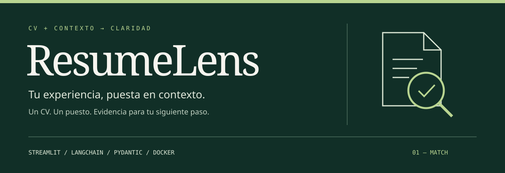
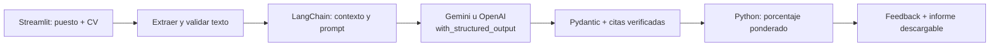
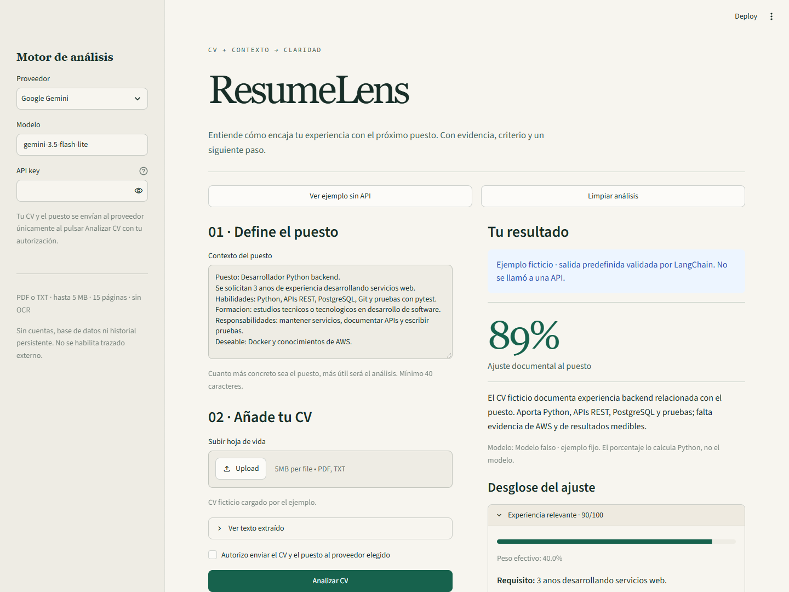
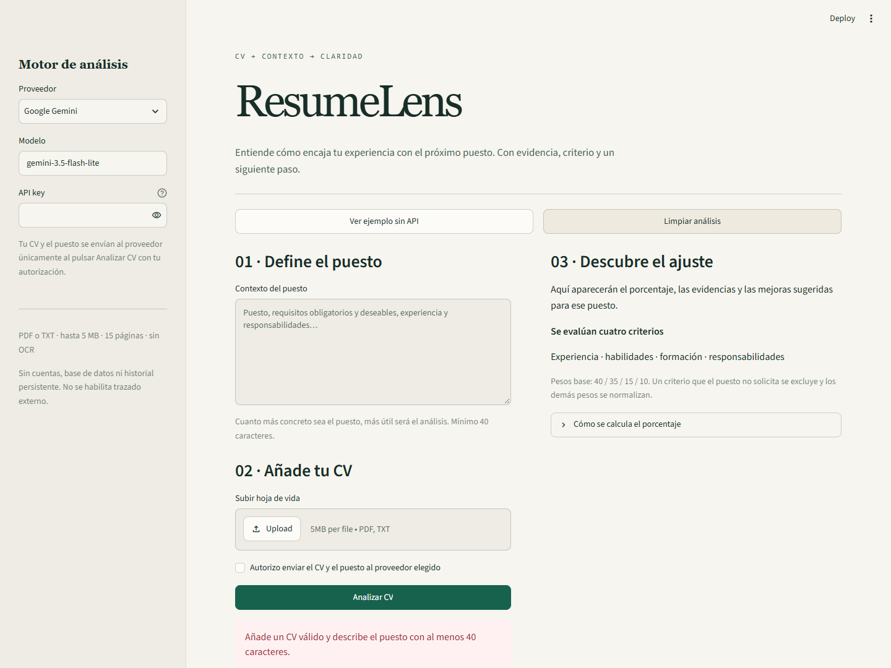
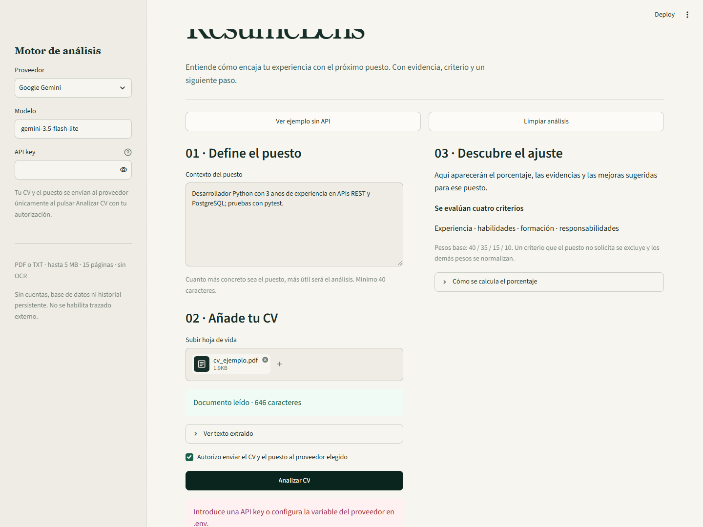
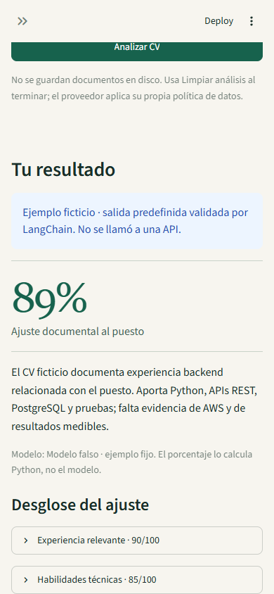

<div align="center">



<br />

[](https://www.python.org/)
[](https://streamlit.io/)
[](https://docs.langchain.com/oss/python/langchain/models)
[](https://github.com/Dvanielx03/ResumeLens-cv/actions/workflows/tests.yml)

**Un CV. Un puesto. Un análisis que explica sus razones.**

[Empezar](#en-marcha) · [Cómo funciona](#del-documento-al-feedback) · [Evidencias](#probado-en-el-navegador) · [Arquitectura](#estructura)

</div>

ResumeLens compara una hoja de vida con el puesto que tú describes. Extrae el texto del CV, utiliza LangChain para analizarlo con Gemini u OpenAI y devuelve un **ajuste documental de 0 a 100**, con evidencias, fortalezas, brechas y próximos pasos.

La aplicación mantiene una estructura por capas sencilla, adaptada de Garaje: **presentación, servicios, dominio e integración con el modelo**. Sin cuentas, base de datos ni servicios adicionales.

## Lo que puedes hacer

| Preparar | Comprender | Actuar |
| --- | --- | --- |
| Describir requisitos y responsabilidades del puesto. | Revisar un porcentaje con cuatro criterios y pesos visibles. | Descargar un informe Markdown con feedback y citas. |
| Subir un PDF con texto seleccionable o un TXT UTF-8. | Ver qué evidencia del CV respalda cada criterio. | Mejorar el documento con siguientes pasos concretos. |
| Elegir proveedor, modelo y API key. | Probar un ejemplo ficticio sin consumir API. | Limpiar el análisis y empezar otro. |

## En marcha

### Con Docker — recomendado

Requiere Docker Desktop iniciado y Docker Compose con soporte de `env_file.required` (2.24 o posterior).

```bash
git clone https://github.com/Dvanielx03/ResumeLens-cv.git
cd ResumeLens-cv
docker compose up -d --build
```

Abre **[localhost:8503](http://localhost:8503)**. Pulsa **Ver ejemplo sin API** para recorrer el caso ficticio sin configurar credenciales.

Para un análisis real:

1. Elige **Google Gemini** u **OpenAI** en la barra lateral; en móvil se abre desde la esquina superior izquierda.
2. Introduce tu API key y, si lo necesitas, cambia el identificador del modelo.
3. Escribe el contexto del puesto y sube el CV.
4. Revisa el texto extraído, autoriza el envío y pulsa **Analizar CV**.
5. Consulta el desglose y descarga el informe.

También puedes copiar `.env.example` a `.env` y configurar `GOOGLE_API_KEY` u `OPENAI_API_KEY` antes de iniciar Docker. No hace falta configurar los dos proveedores. La clave introducida en la interfaz tiene prioridad sobre la del entorno.

```bash
docker compose logs -f app
docker compose down
```

Después de cambiar código o variables del contenedor:

```bash
docker compose up -d --build --force-recreate
```

### Sin Docker

```bash
python -m venv .venv
# Windows PowerShell:
.\.venv\Scripts\Activate.ps1
# macOS/Linux: source .venv/bin/activate
python -m pip install -r requirements.txt
python -m streamlit run app/app.py --server.port=8503
```

Usa Python **3.12**. Las dependencias están fijadas en `requirements.txt`; `.env` se carga con `python-dotenv`.

## Del documento al feedback



La integración usa `RunnableLambda`, `ChatPromptTemplate` y `with_structured_output(AnalisisCV)`. La ruta de ejecución separa preparación, invocación y validación para controlar fallos y permitir **una reparación** de esquema o de citas. Los timeouts, HTTP 429 transitorios y errores 5xx permiten hasta dos reintentos; la cuota diaria agotada no se reintenta. La espera del llamador tiene un plazo total de 90 segundos. Una llamada ya iniciada no puede cancelarse por la fuerza; su resultado tardío se descarta.

**El modelo valora la evidencia; Python calcula el porcentaje.** No se utilizan agentes autónomos, búsquedas web, base vectorial ni RAG. El texto del CV y el puesto se incluyen directamente en el contexto.

### Qué significa el porcentaje

| Criterio | Peso base |
| --- | ---: |
| Experiencia relevante | 40% |
| Habilidades técnicas | 35% |
| Formación y certificaciones | 15% |
| Responsabilidades del puesto | 10% |

Cada criterio solicitado recibe una puntuación de 0 a 100. Los criterios no solicitados se excluyen y los pesos restantes se normalizan.

```text
ajuste = Σ(puntuación del criterio × peso base) / Σ(pesos aplicables)
```

Se redondea al entero más cercano, con los medios hacia arriba. En el ejemplo ficticio: `(90×40 + 85×35 + 100×15 + 80×10) / 100 = 88,75 → 89%`.

> [!NOTE]
> El porcentaje mide ajuste documental según el contexto y la valoración del modelo. No es una probabilidad de contratación, una certificación de capacidades ni una recomendación automática de contratar o descartar. Una brecha indica que falta evidencia en el CV presentado.

## Probado en el navegador

Capturas reales de **Chromium con Playwright contra el contenedor Docker**, el 11 de noviembre de 2026, hora de Bogotá. Se utilizaron exclusivamente datos ficticios.



<details>
<summary>Ver inicio, carga de PDF y vista móvil</summary>

**Inicio**



**PDF extraído y mensaje de API key ausente**



**Resultado a 390 px — emulación, no celular físico**



</details>

| Comprobación | Resultado observado |
| --- | --- |
| Pruebas Python, Windows y contenedor Linux | **25 aprobadas** en cada entorno. |
| Auditoría Playwright | **9 comprobaciones aprobadas**, sin errores JavaScript de página. |
| Extracción de PDF | Documento ficticio leído: 646 caracteres. |
| Ejemplo completo | 89%, desglose, cita literal y feedback visibles. |
| Descarga | Informe `resumelens-informe.md` descargado y contenido comprobado. |
| Edición y limpieza | Cambiar el puesto oculta el resultado anterior; limpiar borra contexto, documento y resultado. |
| Entradas inválidas | Se rechazan antes del proveedor. |
| Consentimiento y clave ausentes | Mensajes visibles; no se genera una puntuación alternativa. |
| Contenedor | Salud `healthy`, ejecutándose como usuario no root. |

> [!IMPORTANT]
> La evidencia del 89% corresponde al **ejemplo predefinido con un modelo falso**, que recorre la cadena LangChain y sus validaciones. No es una respuesta de Gemini/OpenAI. No había una API key configurada durante la auditoría: la evaluación generativa real queda pendiente de probar con una clave y cuota válidas. Los adaptadores de ambos proveedores se construyeron correctamente, sin hacer llamadas externas.

Detalle y reproducción en [docs/registro_pruebas.md](docs/registro_pruebas.md).

## Estructura

```text
app/
├── app.py                    Entrada de Streamlit
├── config/settings.py        Variables y límites
├── domain/modelos.py         AnalisisCV, criterios y fórmula
├── llm/
│   ├── prompts.py            Reglas y ChatPromptTemplate
│   └── proveedores.py        Factory Gemini / OpenAI
├── services/
│   ├── documentos.py         Extracción PDF / TXT en memoria
│   ├── evaluacion.py         LangChain, reparación y reintentos
│   └── informe.py            Exportación Markdown
└── ui/
    ├── dependencias.py       Composición y ejemplo sin API
    └── vista.py              Formulario y resultados
ejemplos/                     CV, puesto y salida ficticios
tests/                        Modelos falsos; no consumen APIs
scripts/                      Generación del PDF y auditoría Playwright
docs/                         Portada, evidencias y registro
Dockerfile                    Python 3.12; etapas runtime / test
docker-compose.yml            Una app, puerto 8503
```

Solo se necesita **Factory** para elegir el proveedor. No se añade Repository porque esta versión no persiste documentos ni resultados.

## Pruebas

```bash
python -m pip install -r requirements-dev.txt
python -m ruff check app tests scripts
python -m pytest -q
```

O desde Docker:

```bash
docker build --target test -t resumelens-tests .
docker run --rm resumelens-tests
```

La CI ejecuta lint y pytest con Python 3.12, sin secretos y sin llamadas a proveedores. Las dependencias directas se declaran en `requirements.in`; los archivos `.txt` fijan también las transitivas.

## Límites y privacidad

- PDF con texto seleccionable o TXT UTF-8; hasta **5 MB, 15 páginas y 30.000 caracteres**. El puesto admite entre 40 y 12.000 caracteres. No se implementa OCR ni lectura DOCX.
- Los documentos no se escriben en disco ni se guardan en una base de datos. Los widgets y el resultado viven en la sesión de Streamlit. La descarga guarda únicamente lo que el usuario decide descargar.
- El análisis real envía CV y contexto al proveedor elegido tras el consentimiento. Su política de tratamiento de datos depende de la cuenta y el servicio utilizados.
- Las API keys de la interfaz permanecen en la sesión; `.env` y Secrets están excluidos de Git y de la imagen Docker. El trazado de LangSmith se desactiva al arrancar.
- El prompt excluye datos personales y atributos protegidos de la evaluación. Esto es una instrucción al modelo, no una garantía independiente de ausencia de sesgos.
- Se comprueba que cada cita exista en el CV, pero esto no demuestra que el CV sea verdadero ni que la interpretación del modelo sea correcta. Revisa el informe antes de usarlo.
- Sin autenticación ni limitación de tráfico: esta versión está pensada para uso local o demostración controlada, no para publicar un servicio de selección de personal abierto.

## Referencias

[Modelos y salida estructurada de LangChain](https://docs.langchain.com/oss/python/langchain/models#structured-output) · [Integración Gemini](https://docs.langchain.com/oss/python/integrations/chat/google_generative_ai) · [Modelos Gemini](https://ai.google.dev/gemini-api/docs/models) · [Carga de archivos en Streamlit](https://docs.streamlit.io/develop/api-reference/widgets/st.file_uploader) · [Extracción con pypdf](https://pypdf.readthedocs.io/en/stable/user/extract-text.html)
